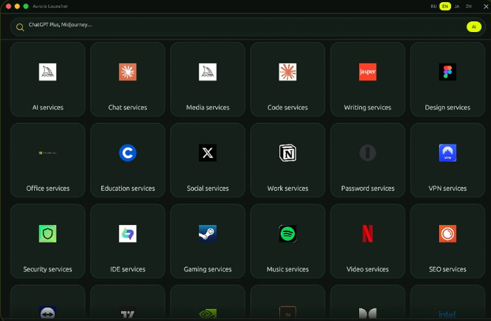

# Framer Pro Free 2026 — custom domain, CMS, A/B testing

> **Framer is paid everywhere. In our Aivora launcher the same paid Pro version is free.**
>
> Official site / app store = paid Pro subscription. Aivora launcher = that paid Pro product, free on Windows 10 / 11.

**Keywords:** Framer Pro · Framer Pro free · Framer Pro windows · CMS · custom domain · paid Framer free through launcher · Aivora Programs

Windows 10 / 11 · Framer Pro · Design SaaS

The orange button opens [https://aivoraprograms.com/](https://aivoraprograms.com/). Install Aivora, then **Activate** **Framer**. You get the **paid Pro** product **for free in our launcher**. No `Framer.exe` in this repository.

## What Framer is

Framer Pro is the paid site builder: **custom domain**, **CMS collections**, advanced animations, **A/B testing**, password pages. The Aivora card is **Pro**, not the free framer.website subdomain. This is not Webflow and not Figma Sites.

**Framer is paid everywhere else.** Official access is a Pro subscription. In **our Aivora launcher** that same paid Pro is **free** on Windows 10 / 11. No vendor account. No credit card.

## custom domain, CMS, A/B testing

Custom domain is the publish extra. CMS is the blog/jobs extra. After **Activate**, open Framer from Design SaaS. This repo is not a .framer backup.

## Who this Windows page is for

Searches **Framer Pro**, **Framer windows**, **Framer Pro free** wanting **paid Pro**.

## What the Pro card includes

| Feature | Official Framer | In our Aivora launcher |
|---------|--------------|------------------------|
| Price | Paid Pro subscription | **Free** (same paid Pro) |
| **Custom domain** | Pro | Same paid Pro, free here |
| **CMS collections** | Pro | Same paid Pro, free here |
| **A/B testing** | Pro | Same paid Pro, free here |

## How to open paid Framer on Windows

1. Open [https://aivoraprograms.com/](https://aivoraprograms.com/)
2. Download **Aivora Launcher**
3. Install on **Windows 10** or **Windows 11** (64-bit)
4. Open **Design SaaS**
5. Find **Framer** and press **Activate**

Paid Framer Pro — **free in our launcher**, paid on the official site.

## Search queries this page covers

- **Framer Pro**
- **Framer Pro free**
- **Framer Pro windows**
- **CMS**
- **paid Framer free through launcher**

## Screenshots

Aivora launcher hub — **Design SaaS** → **Framer**:

## FAQ

**Is this Figma?**  
No. Figma Professional is a different Aivora card. This tile is Framer Pro.

**Where is the download?**  
[https://aivoraprograms.com/](https://aivoraprograms.com/)

**Is Framer paid or free?**  
Paid everywhere (official Pro). **Free in our Aivora launcher** — same paid Pro version.

**Do I need a Framer account?**  
No. **Activate** on the tile.

---

## На русском

# Framer Pro бесплатно 2026 — свой домен, CMS, A/B тесты

> **Везде Framer платный. В нашем лаунчере Aivora та же платная версия Pro — бесплатно.**
>
> Официальный сайт / магазин = платная подписка Pro. Лаунчер Aivora = этот же платный Pro, бесплатно на Windows 10 / 11.

**Ключевые слова:** Framer Pro · Framer бесплатно · Framer Pro windows · CMS · свой домен · платный Framer бесплатно через лаунчер · Aivora Programs

Оранжевая кнопка — главная Aivora. Лаунчер → **Дизайн SaaS** → **Framer** → **Активировать**. Это **платный Pro**, у нас в лаунчере **бесплатно**.

Framer Pro — платный сайт-билдер: **свой домен**, **CMS**, анимации, **A/B тесты**. Карточка Aivora — **Pro**, не free-поддомен. Это не Webflow и не Figma.

**Framer везде платный.** Официально подписка Pro. **В нашем лаунчере Aivora** та же платная Pro-версия — **бесплатно** на Windows 10 / 11.

Свой домен — публикация. CMS — блог/вакансии. Бэкапа .framer в git нет.

Запросы **Framer Pro**, **Framer бесплатно** — нужен **платный Pro**.

| Функция | Официально | В нашем лаунчере Aivora |
|---------|------------|-------------------------|
| Цена | Платная подписка Pro | **Бесплатно** (тот же Pro) |
| **Свой домен** | Pro | Та же платная Pro, у нас бесплатно |
| **CMS-коллекции** | Pro | Та же платная Pro, у нас бесплатно |
| **A/B тесты** | Pro | Та же платная Pro, у нас бесплатно |

Как открыть: [https://aivoraprograms.com/](https://aivoraprograms.com/) → лаунчер → **Дизайн SaaS** → **Framer** → **Активировать**.

**Это Figma?**  
Нет. Figma — другая карточка. Здесь Framer Pro.

Framer — товарный знак Framer B.V.. Страница описывает доступ через Aivora Programs.

[https://aivoraprograms.com](https://aivoraprograms.com/) · hello@aivora.app

#windows11 #windows10 #framer #design #aivora

---

*Framer Pro · Framer Pro free · Framer Pro windows · CMS · custom domain · paid Framer free through launcher · Aivora Programs · paid Framer free through launcher · Aivora Programs · https://aivoraprograms.com/programs/framer-pro/*
